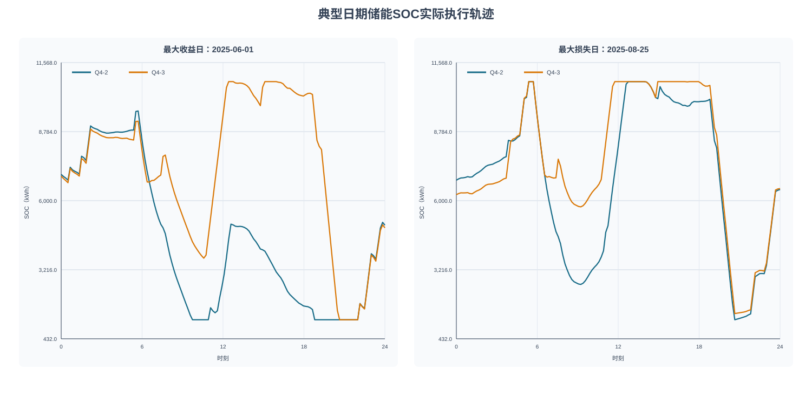
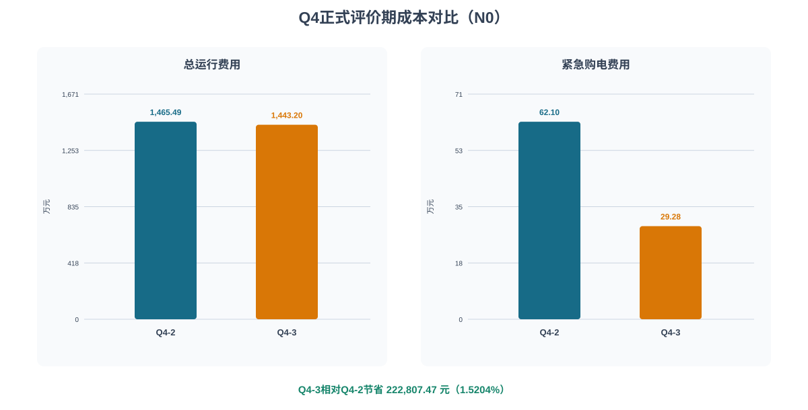
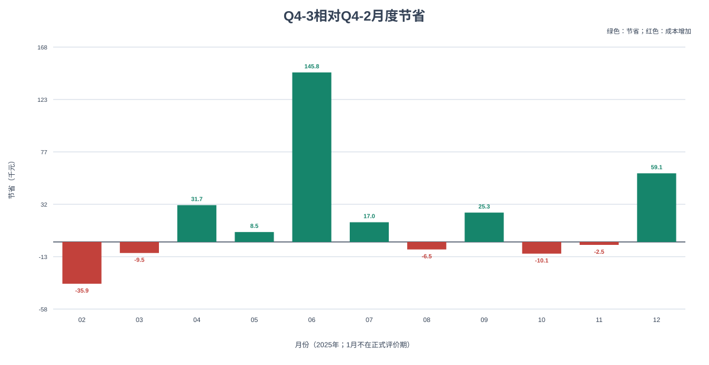
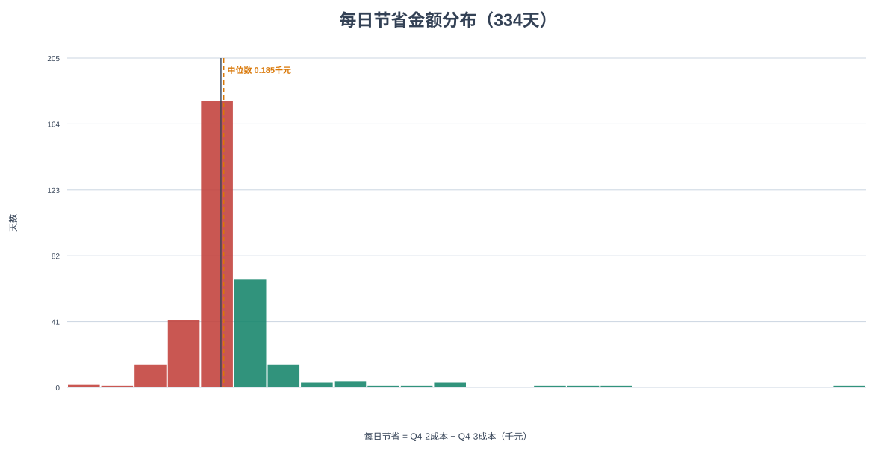
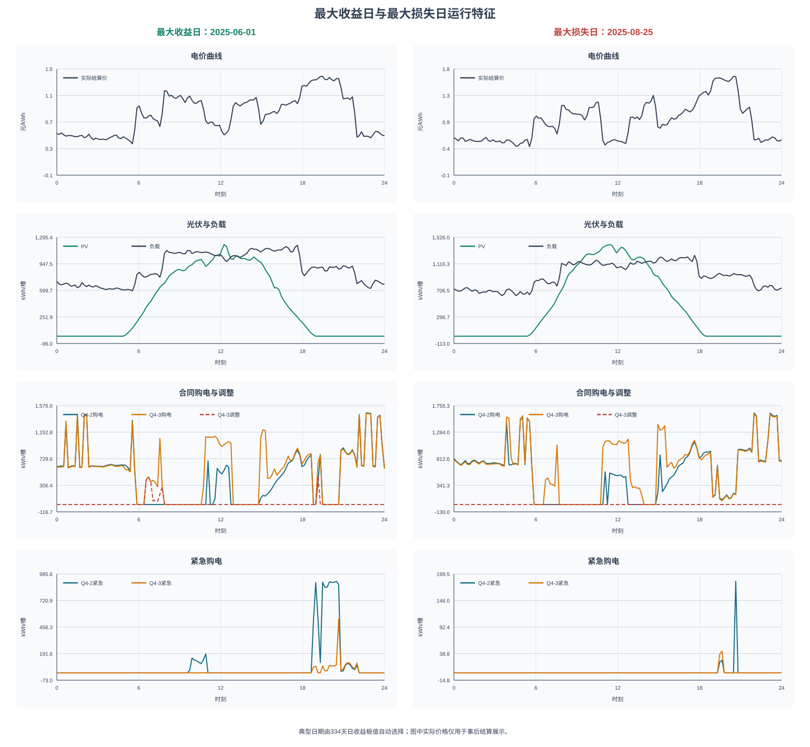

# Q4最终审查与论文支撑报告

## 摘要

本报告在Q4正式模型完全冻结的前提下，整合规划—执行一致性、收益归因、全年稳定性和已有敏感性证据。正式评价期为2025-02-01至2025-12-31，共334天、48,096个10分钟时段。Q4-3相对Q4-2降低费用222,807.47元，降幅1.5204%。该优势可以由正式账本复算，但日级与月级表现存在波动，论文应将其表述为全年平均经济性改善，而不是逐日一致占优。

## 一、模型保持说明

本阶段属于模型外部验证增强。Q4目标函数、物理约束、风险参数、优化流程、F0实际执行控制器和正式结果均未改变，也未重新训练预测模型。Q4-2仍采用P2p价格预测和风险参数0.80；Q4-3仍采用风险参数(0.70, 0.65)，并仅在6:00、12:00和18:00使用当时已发布预测调整剩余合同量。正式`price_gamma=0`，未来真实价格未参与决策；账本中的实际价格仅用于交付后的费用结算和本报告的事后展示。

正式结果目录`outputs/q4_final/`保持只读。本报告、图表和中间统计均写入`docs/q4/`、`analysis/q4_review/`和`outputs/q4/paper_figures/`。

## 二、执行一致性验证

源码审计确认优化器内部能够生成计划充电、计划放电和计划SOC，但正式结果只持久化合同购电量，未保存计划储能轨迹。因此，冻结历史证据不能计算`actual_charge-charge_plan`、`actual_discharge-discharge_plan`和`actual_SOC-SOC_plan`，也不能将这些偏差宣称为零。新增分析接口可以在未来获得独立计划日志后执行比较，本次没有调用求解器补造历史轨迹。

可独立验证的是实际执行账本与F0规则的一致性。分析程序未导入Q4 solver，而是独立重写单时段F0公式，对Q4-2和Q4-3各48,096个时段逐槽复算充电、放电、紧急购电、弃电及SOC。结果如下。

| 策略 | 复核时段 | 平均绝对误差 | 最大绝对误差 | SOC最大误差 |
|---|---:|---:|---:|---:|
| Q4-2 | 48,096 | 4.269e-14 | 5.457e-12 | 5.457e-12 |
| Q4-3 | 48,096 | 4.422e-14 | 5.457e-12 | 5.457e-12 |

该结果证明正式账本忠实执行既定F0规则，但不等价于证明优化计划储能轨迹与F0轨迹一致。最终费用直接由实际合同、紧急购电和结算价复算，因此计划轨迹缺失不破坏费用对账结论，却构成机制解释方面的证据局限。

**图4说明：** 最大收益日和最大损失日均由334天日收益极值自动确定；曲线为正式账本中的实际SOC，不是未保存的计划SOC。

## 三、经济收益来源分析

| 策略 | 全年费用/元 | 相对Q4-2节省/元 | 节省率/% | 紧急购电费/元 |
|---|---|---|---|---|
| Q4-2 | 14,654,856.78 | 0.00 | 0.0000 | 621,019.72 |
| Q4-3 | 14,432,049.32 | 222,807.47 | 1.5204 | 292,758.66 |

Q4-3的净节省不是单一费用项造成。按正式结算恒等式分解，正贡献表示该项使Q4-3相对Q4-2更便宜，负贡献表示抵消节省。

| 费用分项 | 贡献/元 | 占净节省/% |
|---|---|---|
| 原合同购电费用 | 203,378.32 | 91.28 |
| 上调购电费用 | -308,831.92 | -138.61 |
| 下调违约费用 | 0.00 | 0.00 |
| 下调退款 | 0.00 | 0.00 |
| 紧急购电费用 | 328,261.07 | 147.33 |

原合同购电费用下降贡献203,378.32元，紧急购电费用由621,019.72元降至292,758.66元，贡献328,261.07元；与此同时，合同上调费用增加308,831.92元，抵消部分收益。五个分项与净节省的对账误差低于1e-6元。

该分解回答的是费用从哪里变化，不能替代机制因果消融。全年正式数据只有Q4-2与完整Q4-3，缺少正交的全年“仅信息更新、不调整合同”策略，因此无法把信息更新与滚动调整拆成唯一比例。冻结的1月15—31日候选显示，相同Q4-3风险配置下，Rall/γ=0成本为977,900.63元，R0成本更高；但这是17天局部证据，且不能外推成全年独立贡献。正式`price_gamma=0`，所以日内价格误差修正对正式全年节省的直接贡献为0。

## 四、全年稳定性分析

334天中，Q4-3在187天节省费用，占55.99%；在147天费用更高，占44.01%。正式评价期11个月中，正节省月份6个、负节省月份5个。1月不在正式评价期，不填造成本。

| 月份 | 天数 | 节省/元 | 节省率/% | 收益天 | 损失天 | 累计节省/元 |
|---|---|---|---|---|---|---|
| 2025-02 | 28 | -35,941.02 | -2.848 | 10 | 18 | -35,941.02 |
| 2025-03 | 31 | -9,502.11 | -0.837 | 9 | 22 | -45,443.13 |
| 2025-04 | 30 | 31,666.43 | 3.366 | 20 | 10 | -13,776.70 |
| 2025-05 | 31 | 8,520.17 | 0.877 | 21 | 10 | -5,256.53 |
| 2025-06 | 30 | 145,837.26 | 9.339 | 26 | 4 | 140,580.73 |
| 2025-07 | 31 | 16,954.00 | 0.989 | 14 | 17 | 157,534.73 |
| 2025-08 | 31 | -6,453.39 | -0.454 | 15 | 16 | 151,081.34 |
| 2025-09 | 30 | 25,257.91 | 2.146 | 20 | 10 | 176,339.25 |
| 2025-10 | 31 | -10,055.50 | -0.878 | 16 | 15 | 166,283.74 |
| 2025-11 | 30 | -2,536.48 | -0.191 | 17 | 13 | 163,747.27 |
| 2025-12 | 31 | 59,060.20 | 2.955 | 19 | 12 | 222,807.47 |

日收益中位数为184.72元，标准差为4,584.28元。收益最高5天合计140,483.00元，占全年净节省63.05%；剔除这5天后仍节省82,324.47元。因此优势并非完全由5天产生，但收益集中度较高，不能宣称逐日稳定占优。

| 案例 | 日期 | Q4-2费用/元 | Q4-3费用/元 | 节省/元 | Q4-2紧急购电/kWh | Q4-3紧急购电/kWh |
|---|---|---|---|---|---|---|
| 最大收益日 | 2025-06-01 | 110,240.51 | 64,320.31 | 45,920.20 | 10,545.79 | 1,604.13 |
| 最大损失日 | 2025-08-25 | 57,597.88 | 68,542.79 | -10,944.91 | 232.18 | 81.53 |

典型日期不是人工挑选，而是固定规则选择最大收益日2025-06-01和最大损失日2025-08-25。图中实际价格仅作为事后结算环境展示，不参与当时决策。

## 五、敏感性分析

### 5.1 结算规则敏感性

| 结算规则 | Q4-2费用/元 | Q4-3费用/元 | Q4-3相对节省/元 | 节省率/% |
|---|---:|---:|---:|---:|
| N0 | 14,654,856.78 | 14,432,049.32 | 222,807.47 | 1.5204 |
| N1 | 14,654,856.78 | 14,238,158.26 | 416,698.52 | 2.8434 |

Q4-3在N0和N1两种已有结算规则下均优于Q4-2，说明优势方向对结算口径具有一定稳健性。但N1费用较低来自结算规则变化，不应被解释为模型结构改进。

### 5.2 风险参数与更新时间

正式参数由1月15—31日的因果影子回测预先选择，2—12月未参与调参。已有候选覆盖Q4-2风险分位数0.50、0.70、0.80、0.90，Q4-3多组(α0, αupdate)、8种更新时间集合和γ∈{0,1}。这些结果支持所选配置并非未经比较的单点设定，但评价窗口仅17天，不能等价于跨年度参数稳定性。

### 5.3 终端SOC

正式规划采用6,000 kWh终端目标，正式回放在评价末日闭合。当前没有软约束或48小时跨日窗口的冻结结果；遵守本阶段禁止修改模型和禁止大规模重算的约束，本报告不为这两种方案填造成本。论文可将其列为后续实验设计：保持其余参数不变，分别比较硬约束、绝对偏差惩罚和48小时滚动窗口的费用、末端SOC偏差与运行时间。

## 六、模型局限性

1. 计划充放电和计划SOC未持久化，无法对历史计划—执行偏差作直接定量验证。
2. 全年正式结果缺少正交B1，信息更新与合同调整的因果贡献不能唯一拆分。
3. 价格模型P0p/P1p没有对应的全年调度成本，因此不能证明预测MAE排序必然等于经济成本排序。
4. 收益存在集中性：44.01%的评价日费用上升，5个高收益日贡献63.05%的净节省。
5. 正式证据来自2025年单年度因果回测，尚不能替代跨年度或不同市场环境的外部验证。
6. 终端SOC软约束与48小时窗口只有实验设计，没有现成结果。
7. 实际价格、实际PV和实际负载在本报告中用于事后结算和解释；这证明信息边界合理，但仍应与真实在线部署的预测漂移风险区分。

## 七、论文写作建议

### 建议保留的正文内容

1. 用图1及全年成本表作为主结果，报告绝对节省、相对节省和紧急购电下降。
2. 用会计分项表解释收益渠道，并明确它不是机制因果消融。
3. 用图2、图3及TOP5集中度说明优势的月度、日级和尾部稳定性。
4. 用图4说明实际SOC轨迹受物理边界约束，同时在图注中写明它是执行轨迹而非计划轨迹。
5. 用图5同时展示最大收益和最大损失案例，避免只展示有利日期。
6. 在稳健性小节保留N0/N1比较；终端SOC替代方案只放在局限性或未来工作，不报告未经运行的数字。

### 推荐的论文表述

> 在334天因果回测中，Q4-3相对Q4-2降低总运行费用222,807.47元（1.5204%）。费用分解表明，收益主要由原合同购电费用和紧急购电费用下降形成，但部分收益被合同上调费用抵消。Q4-3在55.99%的日期和6个评价月份中占优；剔除最高收益5天后仍保持82,324.47元净节省，说明全年优势不完全依赖极少数日期，但其日级与月级波动仍需谨慎解释。

### 不建议使用的表述

- 不写“规划与执行完全一致”；应写“实际账本与F0规则一致，计划轨迹未落盘”。
- 不把222,807.47元全部归因于PV预测更新或动态价格；正式动态价格修正贡献为0。
- 不写“所有月份稳定节省”或“每日均占优”。
- 不报告软终端约束、48小时窗口或P0p/P1p全年经济成本的虚构数值。

## 八、论文图表索引

| 图号 | 文件 | 建议位置 |
|---|---|---|
| 图1 | `figure_1_annual_cost_comparison.svg` | Q4主结果 |
| 图2 | `figure_2_monthly_savings.svg` | 稳定性分析 |
| 图3 | `figure_3_daily_savings_distribution.svg` | 尾部与分布分析 |
| 图4 | `figure_4_soc_trajectories.svg` | 执行一致性与物理解释 |
| 图5 | `figure_5_typical_dates.svg` | 典型日案例 |

全部图表均由冻结账本或已核验派生CSV生成，未调用Q4 solver。SVG为矢量格式，可直接插入论文或转换为PDF。
