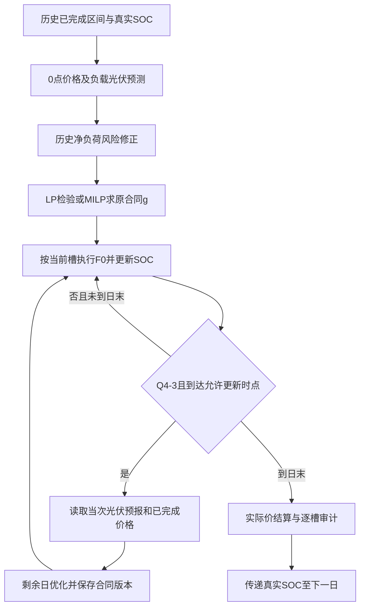

# 第四问数学模型设计说明

版本：v1.1｜日期：2026-09-12｜状态：模型已实现并完成短窗口、1月冻结选型和334天回测；结果见`outputs/q4_final/`。

本文说明《C题 微网与外部电网电力调控策略》第四问的数学模型、信息假设、算法与验证方案。设计包括波动电价下的日前购电策略Q4-2，以及允许日内调整的Q4-3。实现已按本文口径完成，N0主结果分别保存为`outputs/q4_final/result4-2.xlsx`和`outputs/q4_final/result4-3.xlsx`，N1敏感性副本位于`outputs/q4_final/N1/`；数值分析见[第四问求解与结果分析](result/第四问求解与结果分析.md)。

阅读顺序：第2—5节确定信息、计费和物理边界；第6—9节给出可执行主设计；第10、13节列出扩展；第11—12、14节规定算法、历史选型与验收。

## 1. 设计结论与适用范围

主线采用**因果电价预测—净负荷风险修正—LP/MILP合同规划—连续状态反馈执行**。Q4-2在每天0点冻结全天合同；Q4-3在0点形成原合同，并在允许的6、12、18点滚动规划当天剩余区间。两者首先共用已验证的F0执行控制与评价末日闭合规则，以区分价格预测、光伏预报和合同调整各自的影响。

联合价格—净负荷场景随机规划作为增强候选；CVaR与价格感知储能控制作为后续独立扩展。预算鲁棒、分布鲁棒、完整场景树、强化学习不进入首轮主模型。模型家族已明确，具体预测器、风险分位数和发布时间组合由因果历史验证选定，不能直接沿用Q3获选数值并称为Q4最优参数。

这里的LP/MILP是每次规划的优化模型，滚动优化是决策组织方式，F0是实际执行规则。三个层次必须分开。规划最优不等于预测正确，也不等于整个在线策略在真实随机环境中全局最优。

| 内容 | 本文采用的主设计 | 状态 |
|---|---|---|
| 价格信息 | 未来实际价未知，仅使用已完成区间的实际价格 | 建模假设 |
| 价格结算 | 对目标交付区间，使用附件4该区间实际价格结算 | 建模解释，不是已核实的市场制度 |
| 合同下调 | N0不退款为主；N1退款为歧义敏感性 | 延续Q3解释，分别计算 |
| 预测与规划 | P0p/P1p/P2p价格点预测、历史净负荷残差分位数、剩余日LP/MILP | 已实现主线；扩展消融另列 |
| 实际储能控制 | 当前区间盈缺F0，真实SOC跨日连续 | 复用机制，Q4仍须验证 |
| 不确定性增强 | 联合历史残差场景，共享储能控制的受限随机规划 | 候选扩展，非已取得效果 |
| 风险扩展 | 期望费用加费用CVaR | 仅敏感性，不替换题设目标 |

## 2. 数据、时间轴与信息边界

### 2.1 输入和计量

沿用现有标准化数据，不重清洗、不静默删除异常值、不重新平移时间轴。

| 输入 | 作用 | 使用限制 |
|---|---|---|
| `annual_actual_10min.csv`中的负载与光伏 | 历史训练、实际执行与事后评价 | 当日未来实际值不能用于规划 |
| 同表`price_yuan_per_kwh` | 历史价格预测与实际结算 | 读取完整文件不代表决策获得完整价格路径 |
| `pv_forecast_hourly.csv` | Q4-3当次已发布光伏预报 | 按发布时刻、相对预报时距定位 |
| Q2已生成的因果预测缓存 | 负载预测及Q4-2历史光伏预测 | 核对生成协议与输入哈希，保持每条预测的历史来源 |
| `templates/result4-2.xlsx`、`result4-3.xlsx` | 后续结果导出 | 不覆盖输入模板 |

以上文件位于[标准化数据目录](../C题_标准化数据与修正模板/C_final_delivery/README.md)及现有Q2输出目录。当前未取得清洗前原附件，不能宣称已独立证明原始附件到标准化字段的映射。

日期记为$i$，10分钟区间编号$t\in\{0,\ldots,143\}$，状态边界编号$b\in\{0,\ldots,144\}$。每槽时长$\Delta t=1/6$小时；$L,V,g,q,c,d,e,w,s$均为交流母线侧kWh，$E$为电池内部kWh，$p$为元/kWh。已提供的kWh字段不再乘时间步长。

正式输出区间为2025年2月1日至12月31日，共334天、48,096槽；1月用于初始化和历史验证。全文费用报告必须区分这334天与全年365天。

### 2.2 可用信息集合

令$\theta_{i,t}$为区间起点，$\tau_{i,r}$为当日$6r$:00，$t_r=36r$，$r=0,1,2,3$。主设计假设区间价格、负载和光伏在该区间结束后进入历史数据库，无额外报告延迟。

在合同决策时刻$\tau$，信息集合$\mathcal I_\tau$包含：

1. 结束时间不晚于$\tau$的历史负载、光伏和实际电价；
2. 当前储电量$E^{\mathrm{act}}_{i,t_r}$及既有合同版本；
3. 日历信息、当时已经训练好的预测器与残差库；
4. 对Q4-3，发布时间不晚于$\tau$且属于允许使用版本的附件3预报。

例如6点决策可使用05:50—06:00的实际价格，不可使用06:00—06:10或之后的实际价格。主设计不假设价格在区间开始前公布。附件4没有价格预测发布表，因此自行建立因果预测器。

F0执行层沿用Q2/Q3的理想即时反馈假设：区间内能够响应当前负载和光伏盈缺，在10分钟汇总模型中实现平衡。这与提前知道未来区间不同；若研究测量延迟，须另设敏感性，不能把当前反馈结果冒称具有延迟条件下的可实现性证明。

### 2.3 Q4-2与Q4-3的区别

| 项目 | Q4-2 | Q4-3 |
|---|---|---|
| 原合同$g$ | 每天0点确定 | 每天0点确定 |
| 日内合同更新 | 不允许，始终$q^{\mathrm{exe}}=g$ | 允许在所选6、12、18点更新 |
| 负载预测 | 复用同源因果日前预测 | 主线使用同一负载预测，日内先不额外更新 |
| 光伏预测 | 延续Q2仅用历史实际信息的预测 | 0点及允许日内时刻使用附件3 |
| 价格观测规则 | 相同 | 相同 |
| 价格预测更新 | 新观测不改变已冻结合同 | 允许合同更新时，用已完成价格区间更新预测 |
| 实际执行 | 共享F0 | 共享F0 |

Q4-2不因第四问同时列出附件3就自动引入新预报，否则将混淆“重新计算问题2”和“问题3所增加的信息”。若另做Q4-2使用0点附件3的变体，应明确标为信息消融。

### 2.4 光伏预报映射

Q4-3沿用Q3的H0假设：当次发布的第$h$小时预报对应标准化窗口$[\tau+(h-1)\mathrm h,\tau+h\mathrm h)$，在该小时内视为恒定功率。窗口内每个10分钟槽取该功率的$1/6$，得到kWh。6、12、18点分别只取当次预报的前18、12、6小时用于当天剩余规划，不能把相对时距误当成当天绝对钟点。

H0是建模近似，原附件整点瞬时功率语义仍有核对边界；不将插值效果写成已经验证的优势。

## 3. 理想决策问题与可计算近似

理论目标是在可用信息约束下选择合同和控制策略，使输出期条件期望费用最小：

$$
\min_{\text{满足信息边界的策略}}
\mathbb E\!\left[\sum_{i\in\mathcal D_{\mathrm{out}}}C_i^{\mathrm{tot}}
\mid\mathcal I_{\text{2025-02-01 00:00}}\right]. \tag{1}
$$

策略还应满足第5节物理约束和相应合同冻结规则。当前没有真实联合概率分布，也没有实现全年多阶段动态随机优化；因此式(1)用于说明目标，不直接作为已求解模型。

主设计用每次可获得的预测路径和历史风险修正构造可解的LP/MILP，再以F0真实回放评价。式(1)中的实际费用、规划目标$J_\tau$与求解器目标值不是同一件事。尤其不能把点预测确定性模型的目标称为真实期望费用的精确值。

## 4. 合同版本与结算模型

### 4.1 版本定义

$g_{i,t}\ge0$为0点原始合同，$q^{[\tau]}_{i,t}\ge0$为某次调整后的合同总量，$q^{\mathrm{exe}}_{i,t}$为交付前最后有效版本。定义

$$
\delta^{[\tau]}_{i,t}=q^{[\tau]}_{i,t}-g_{i,t},\qquad
\Delta q^{[\tau]}_{i,t}=q^{[\tau]}_{i,t}-q^{\mathrm{prev}}_{i,t\mid\tau}. \tag{2}
$$

二者分别是相对原合同的净偏差和本次版本变更，不能混用。对已执行区间，不允许新版本改写。0点$q^{[\tau_{i,0}]}=g$；Q4-2在全天都保持这一等式。

### 4.2 主结算N0

设$[x]_+=\max(x,0)$。按目标交付区间实际价结算、原合同不退款、最终净调整只计费一次，定义

$$
K^{N0}_{i,t}(g,q;p)
=p\{g+1.5[q-g]_++0.5[g-q]_+\}. \tag{3}
$$

于是Q4-2实际费用为

$$
C_i^{4\text{-}2}=\sum_{t=0}^{143}p^{\mathrm{act}}_{i,t}g_{i,t}
+5\sum_{t=0}^{143}p^{\mathrm{act}}_{i,t}e_{i,t}; \tag{4}
$$

Q4-3主结算实际费用为

$$
C_i^{4\text{-}3,N0}
=\sum_{t=0}^{143}K^{N0}_{i,t}
(g_{i,t},q^{\mathrm{exe}}_{i,t};p^{\mathrm{act}}_{i,t})
+5\sum_{t=0}^{143}p^{\mathrm{act}}_{i,t}e_{i,t}. \tag{5}
$$

拒收$w$不冲减已付合同费用。中间版本只做审计，不把其相对原计划的累计差额再次收费。本题未给出下单时锁定的远期报价，故不引入锁价、价差收益或额外交易费。

### 4.3 N1敏感性与解析校验

N1允许取消部分先冲回原款，再收取50%违约费：

$$
K^{N1}_{i,t}(g,q;p)
=p\{g+1.5[q-g]_+-0.5[g-q]_+\}. \tag{6}
$$

N1中原计划费、上调费、下调违约费和退款分别记账；只在总费用中作净抵扣。N0/N1须独立历史选型，不因某口径全年更便宜就认定它是题目的唯一解释。

以下为人为构造的单槽解析例，不是Q4结果。若$g=1000$ kWh、$p=0.6$元/kWh：

| 最终合同$q$ | N0常规合同费 | N1常规合同费 |
|---|---:|---:|
| 1000 kWh | 600元 | 600元 |
| 1200 kWh | 780元 | 780元 |
| 800 kWh | 660元 | 540元 |

若另紧急购电100 kWh，两种结算都再加300元，不得按原价再重复增加60元。

在$p>0$、允许免费拒收已付合同、没有额外接收上限的N0模型中，$q<g$被$q'=g$、$w'=w+(g-q)$支配：实际供能不变，$w'\le q'$仍成立，且省去下调违约费。因此N0最优合同可以不下调；零下调并不意味着日内预报无价值。N1可能因退款而下调。这个结论依赖本文假设，不推广到禁止拒收或逐次收费的市场。

## 5. 共用物理模型和终端条件

### 5.1 单槽平衡与储能

对任何明确标注的规划、场景或实际轨迹，均采用以下结构；实际轨迹使用真实$L,V$和最终合同$q^{\mathrm{exe}}$：

$$
q-w+e+V-s+d=L+c, \tag{7}
$$

$$
E_{t+1}=E_t+\eta_c c_t-\frac{d_t}{\eta_d},
\qquad\eta_c=\eta_d=0.9, \tag{8}
$$

$$
1200\le E_b\le10800,
\quad0\le c_t\le\bar c z_t,
\quad0\le d_t\le\bar d(1-z_t),
\quad z_t\in\{0,1\}, \tag{9}
$$

$$
\bar c=\bar d=5000/6,\qquad
q_t,e_t\ge0,\quad0\le w_t\le q_t,\quad0\le s_t\le V_t. \tag{10}
$$

实际外网接收量为$G^{\mathrm{act}}=q^{\mathrm{exe}}-w^{\mathrm{act}}+e$，与付费合同量不同。模型不售电、不允许最终缺供，不设置题目未给的外网购电上限。$s$只能来自光伏，不能把电池放出的电记作弃光。

### 5.2 初始、跨日和末端

为保持与Q2/Q3公平衔接，1月实际储能待机，保持6000 kWh；1月影子验证是独立模拟，不改变实际初始状态。2月1日以6000 kWh开始，并满足

$$
E^{\mathrm{act}}_{i+1,0}=E^{\mathrm{act}}_{i,144}. \tag{11}
$$

每次剩余日规划采用

$$
E^{[\tau]}_{i,t_r}=E^{\mathrm{act}}_{i,t_r},\qquad
E^{[\tau]}_{i,144}=E_i^{\mathrm{plan}}=6000. \tag{12}
$$

式(12)是策略设计中的规划目标，并非题设要求每天实际回到6000。实际只在整个评价期末要求

$$
E^{\mathrm{act}}_{\text{2025-12-31},144}=E^{\mathrm{close}}=6000. \tag{13}
$$

闭合所需的真实购电和充放电必须计入费用。不得通过重置SOC、虚拟放电或末日免费补电满足式(13)。短窗口验证仅在共同窗口末日闭合；正式回测不在每月末重置。

主设计只规划当天剩余区间，不把跨日预报自动变成次日已签合同。规划日循环目标$E^{[\tau]}_{i,144}=E^{\mathrm{act}}_{i,t_r}$或开放末端价值函数均不纳入主线。

## 6. 因果预测与净负荷风险修正

### 6.1 电价预测

先建立以下三个固定结构候选，再进行历史评价：

| 标签 | 结构 | 作用 |
|---|---|---|
| P0p | 最近7个完整日期同槽价格均值 | 可解释基准与冷启动回退 |
| P1p | 昨日同槽价格与最近7日同槽均值的固定加权平均：`0.35/0.65` | 收缩统计候选 |
| P2p | 28日局部均值与同星期季节均值集成 | 稳健非线性/季节对照候选 |

P1p/P2p只使用此前完成日期的同槽价格、局部均值、星期分组均值和当前已完成价格的水平修正；不加入未来实际负载、光伏、价格或未经提供的天气数据。P1p的权重 `0.35/0.65` 是预先固定的实现参数，不是拟合得到的 Ridge 系数。主历史窗口不超过56个完整日期。样本不足时使用P0；1月8日起可生成具有7日历史的预测。P2p在实现中采用上述局部/季节历史集成，而非引入额外外生变量。

结构性超参数应在实施协议中预先固定，或只在过去训练窗口内按时间顺序验证；不得在334天输出费用上反复搜索。当前实现的三个候选均为历史价格的固定统计组合，最终预测统一作以下正值保护：

$$
\widehat p_{i,t\mid\tau_{i,0}}
=\max\{\epsilon_p,\ f_m(\text{历史价格及日历特征})\},
\qquad\epsilon_p=10^{-6}\ \text{元/kWh}. \tag{14}
$$

该正值保护只作用于预测输出，不修改实际价格；记录触发次数。不得用全年实际最小价设预测下限，也不使用全年最大价截断预测。遇到非有限预测直接报错，不能用裁剪掩盖NaN/Inf。若未来输入出现非正实际价，需要重审结算凸性和适用范围，不能静默改正值。

Q4-3可在允许更新时点加入简单日内偏差修正：以此前最近6个已完成槽相对0点价格预测的平均误差$b^p_{i,r}$修正剩余路径，

$$
b^p_{i,r}=\frac16\sum_{u=t_r-6}^{t_r-1}
\left(p^{\mathrm{act}}_{i,u}-\widehat p_{i,u\mid\tau_{i,0}}\right),
\qquad r=1,2,3, \tag{15}
$$

$$
\widehat p_{i,t\mid\tau_{i,r}}
=\max\{\epsilon_p,\widehat p_{i,t\mid\tau_{i,0}}
+\gamma_p\exp[-(t-t_r)/36]b^p_{i,r}\},\quad t\ge t_r. \tag{16}
$$

$\gamma_p\in\{0,1\}$为冻结的模型候选开关，分别表示不修正和采用修正；36槽对应6小时衰减尺度，是预设策略参数。更新版预测和0点预测都保留，不能覆盖原记录。Q4-2的合同不因式(16)重新签订。

预测评价至少包括分发布时间MAE、RMSE及按月误差，避免用接近零的价格作为MAPE分母。价格模型最终还需通过调度费用对照；预测误差下降不自动构成调度收益。[Lago等关于电价预测评价的综述与基准](https://arxiv.org/abs/2008.08004)支持使用成熟基准和时间顺序评价，不能据此预先断言本数据上的赢家。

### 6.2 净负荷预测与残差

定义$\widehat N_{i,t\mid\tau}=\widehat L_{i,t\mid\tau}-\widehat V_{i,t\mid\tau}$。Q4-2使用现有Q2因果负载、光伏预测；Q4-3使用同源负载预测和当次H0光伏预报。主线优先复用现有`forecasts.npz`的因果在线选择轨迹，另保留Q2原日前规则适配器做退化对照；不静默修改缓存。

对过去完整日期$j<i$、相同发布时刻$r$和目标槽$t$，保留当时实际发出的样本外预测，构造

$$
\varepsilon^N_{j,t\mid\tau_{j,r}}
=N^{\mathrm{act}}_{j,t}-\widehat N_{j,t\mid\tau_{j,r}}. \tag{17}
$$

从此前最多56个完整日期形成$\mathcal H_{i,r}$，取经验分位数

$$
\rho^N_{i,t\mid\tau_{i,r}}
=Q_{\alpha_r}\{\varepsilon^N_{j,t\mid\tau_{j,r}}:j\in\mathcal H_{i,r}\},
\quad
\widetilde N_{i,t\mid\tau}=\widehat N_{i,t\mid\tau}+\rho^N_{i,t\mid\tau}. \tag{18}
$$

$\rho^N$可正可负，是有符号预测修正，不是必为正的购电备用量。不得用今天重新拟合的模型重算全部旧预测，再把拟合残差当作当时可见误差。日内残差库先仅用完整历史日，避免部分标签与整日标签混用。

为复用Q3规划结构，定义有效净负荷分解

$$
\widetilde L=[\widetilde N]_+,\qquad
\widetilde V=[-\widetilde N]_+. \tag{19}
$$

二者是规划中的等效净需求/净剩余，并非新的物理负载或光伏预测。相应$w,s$只是该规划模型的辅助处置量，不输出为实际拒收和弃光；实际统计必须重新代入真实$L,V$并执行F0。

无风险修正对照直接令$\rho^N=0$，不等于自动取$\alpha=0.5$，因为历史残差中位数未必为零。分位数修正是代理策略，不构成全日联合供电概率保证，也不能把无储能单时段特例中的80%分位数直接推广为Q4最优值。

## 7. Q4-2：风险修正的日前合同模型

在$\tau_{i,0}$，给定真实初始SOC、$\widehat p_{i,t\mid\tau_{i,0}}$和式(19)的有效输入，求解

$$
\min J^{4\text{-}2}_{i,0}
=\sum_{t=0}^{143}\widehat p_{i,t\mid\tau_{i,0}}g_{i,t}, \tag{20}
$$

约束为式(7)—(10)中取$q=g$、$e^{[\tau_{i,0}]}=0$、$L=\widetilde L$、$V=\widetilde V$，并满足式(12)的初末状态。决策变量为$g,c^0,d^0,E^0,w^0,s^0,z^0$。

规划不主动安排紧急购电，而通过风险修正后的需求确定合同。真实预测误差导致的$e$在执行层产生，按式(4)全额计费；因此式(20)不等于实际总费用。风险参数必须以包含紧急费的历史执行总费用选择，不能仅比较式(20)。

求解后冻结$g$。计划充放电和规划状态保留用于审计，实际轨迹由第9节F0生成。日内新价格、实际光伏或新预报不改变原合同。该策略计算清楚且易于衔接，但不能预见价格误差与缺口误差的联合影响，此局限由第10节场景扩展研究。

## 8. Q4-3：按发布时刻滚动的合同模型

### 8.1 0点规划

使用附件3的0点预报、同源负载预测和0点价格预测，以式(20)相同结构求得原合同$g$，但风险修正按Q4-3自己的历史残差库计算。主模型不在0点预先假定后续必定获得某种有利预报，也不直接预优化未知未来版本。

### 8.2 日内更新

设$\mathcal R_{\mathrm{upd}}\subseteq\{1,2,3\}$为历史选定的更新集合。在$r\in\mathcal R_{\mathrm{upd}}$时，以真实$E^{\mathrm{act}}_{i,t_r}$、当次光伏预报、更新价格预测和风险修正，优化$t=t_r,\ldots,143$。

引入非负辅助量$\delta^{+,[\tau]},\delta^{-,[\tau]}$，满足

$$
q^{[\tau]}_{i,t}-g_{i,t}
=\delta^{+,[\tau]}_{i,t}-\delta^{-,[\tau]}_{i,t}. \tag{21}
$$

N0日内目标为

$$
\min J^{N0}_{i,r}
=\sum_{t=t_r}^{143}\widehat p_{i,t\mid\tau_{i,r}}
\left(g_{i,t}+1.5\delta^{+,[\tau]}_{i,t}
+0.5\delta^{-,[\tau]}_{i,t}\right). \tag{22}
$$

N1把式(22)的$+0.5\delta^-$替换为$-0.5\delta^-$。其余约束为式(7)—(10)，其中使用本次有效输入、$e^{[\tau]}=0$以及式(12)。原合同项$\widehat p g$在本次优化中是常数，可以在求解时省去，但费用展示和实际结算仍须保留。

因预测价格严格为正，若$\delta^+$、$\delta^-$同时为正，同时减少其较小值不会改变$q$，却会降低N0或N1目标。因此式(21)在最优解中实现正负部分定义，不需要额外二进制变量。

仅更新未执行区间，保持$t<t_r$的合同和全部实际流量不变。若$r\notin\mathcal R_{\mathrm{upd}}$，维持上一版本。每个交付槽从已经发布的有效版本重建$q^{\mathrm{exe}}$，再按式(5)或N1计费。允许更新不意味着每个时点都必须发生非零变更。

这是一种基于最新预测的确定性滚动规划，不是完整场景树随机MPC。[Patrinos等的随机MPC研究](https://cse.lab.imtlucca.it/~bemporad/publications/papers/cdc11-dispatch.pdf)为“预测—约束优化—滚动执行”的框架提供依据；本文没有搬入其中的发电机、售电和其他市场规则。

### 8.3 Q4-2退化接口

另设Q4-2日前规则适配器：在该策略自身当天真实SOC下重新生成Q4-2合同，再选择是否开放日内调整。关闭更新时，应逐槽复现Q4-2的合同、SOC、流量与费用；开放更新时，不能继续拼接原Q4-2独立轨迹的预存合同，因为两条策略的SOC可能已不同。

Q4-3自身0点预报模型的R0不是Q4-2基准。可行集合包含“不调整”不意味着有限候选、代理目标和F0组合在每个真实评价期必然优于Q4-2，应如实报告回测差异。

## 9. 实际执行与安全闭合

### 9.1 普通日期的F0

给定当前合同$q=q^{\mathrm{exe}}_{i,t}$、真实$L,V$和$E=E^{\mathrm{act}}_{i,t}$，令$x=q+V-L$。若$x\ge0$，

$$
c=\min\{x,\bar c,(10800-E)/\eta_c\},\qquad d=0; \tag{23}
$$

若$x<0$，

$$
c=0,\qquad d=\min\{-x,\bar d,\eta_d(E-1200)\}. \tag{24}
$$

随后统一计算

$$
B^{\mathrm{sur}}=x+d-c,\quad e=[-B^{\mathrm{sur}}]_+,
\quad w=\min\{q,[B^{\mathrm{sur}}]_+\},
\quad s=[B^{\mathrm{sur}}]_+-w, \tag{25}
$$

并按式(8)更新真实SOC。合同拒收优先于弃光是现有控制器的固定分配约定；无售电且拒收不退款时，不改变合同费用，但影响两项统计，比较时必须保持一致。

F0不直接使用电价，不主动为未来高价时段保留库存。它首先用于统一对照，不能称为波动电价下最优实时控制。

### 9.2 评价窗口末日

沿用共享安全闭合机制，设目标$T=E^{\mathrm{close}}=6000$，当前槽之后还剩$n=143-t$槽。

若当前$E>T$，设$c=0$，

$$
d=\min\{\bar d,L,\eta_d(E-T)\}. \tag{26}
$$

这保证放电有真实负载去向，不以弃光名义丢弃库存。若$E\le T$，先构造自然反馈目标

$$
E^{\mathrm{nat}}=E+\eta_c[x]_+-[-x]_+/\eta_d,
$$

再将其投影到区间

$$
\left[\max\{1200,T-n\eta_c\bar c,E-\bar d/\eta_d\},\;
\min\{10800,T,E+\eta_c\bar c\}\right]. \tag{27}
$$

由得到的$E'$反推$c=[E'-E]_+/\eta_c$、$d=\eta_d[E-E']_+$，再按式(25)计算购电与处置。低库存时可能为闭合产生紧急购电并充电，必须按当槽5倍实际价计费。

实现必须检测投影区间为空、剩余充电能力不足和最后一槽未达目标等情况，并立即失败。式(26)在未来负载不足时可能无法消耗高库存，不能宣称规则对任意输入都必然可达。不得读取未来真实负载来强行保证闭合；正式数据若失败，先记录证据，再另行设计所有比较策略共同采用的因果闭合规则。

## 10. 联合场景随机规划增强模型

### 10.1 场景生成

在同一发布时间，对每个完整历史日同时保留式(17)的净负荷残差和价格残差$\varepsilon^p=p^{\mathrm{act}}-\widehat p$。用相同历史日期的整条残差路径配对，构造

$$
N^\omega_{i,t\mid\tau}=\widehat N_{i,t\mid\tau}+\varepsilon^{N,\omega}_{t\mid r},
\qquad
p^\omega_{i,t\mid\tau}=\max\{\epsilon_p,\widehat p_{i,t\mid\tau}+\varepsilon^{p,\omega}_{t\mid r}\}. \tag{28}
$$

优先取最近最多28个完整历史日期、等权$\pi_{\omega\mid\tau}=1/|\Omega_\tau|$；14和56条路径用于场景数敏感性，不足时只用已有历史，不能补入未来日期。正值投影次数和场景样本量必须报告。保留路径关联不意味着已证明其代表未来联合分布。

场景模型直接使用式(28)，不再额外叠加式(18)的风险分位数，以免无意重复加风险。价格和缺口可能相关，通常不能将$\mathbb E[pe]$替换为$\mathbb E[p]\mathbb E[e]$。

### 10.2 可计算的受限结构

各场景共享本次合同$q$、储能控制$c,d,z$和状态$E$；各场景拥有自己的$e^\omega,w^\omega,s^\omega$，并令$L^\omega=[N^\omega]_+$、$V^\omega=[-N^\omega]_+$。对每个场景施加式(7)—(10)，初末状态共用式(12)。

Q4-2或Q4-3的0点取$q=g$，最小化

$$
J^{\mathrm{SP}}_{i,0}
=\sum_{\omega\in\Omega_\tau}\pi_{\omega\mid\tau}
\sum_t p^\omega_{i,t\mid\tau}(g_{i,t}+5e^\omega_{i,t}). \tag{29}
$$

Q4-3日内固定原合同$g$，最小化

$$
J^{\mathrm{SP},N}_{i,r}
=\sum_{\omega\in\Omega_\tau}\pi_{\omega\mid\tau}
\sum_{t=t_r}^{143}\left[K^{N}_{i,t}(g_{i,t},q_{i,t};p^\omega_{i,t\mid\tau})
+5p^\omega_{i,t\mid\tau}e^\omega_{i,t}\right],\quad N\in\{N0,N1\}. \tag{30}
$$

此时场景中的$p^\omega$是已生成的参数，不是决策变量，所以$p^\omega e^\omega$是线性项。该模型仍可写成LP/MILP。场景紧急补购是当前场景平衡中的补救量，不是缺供。

共享储能避免让模型预知整条场景后自由选择未来充放电，却也较保守。它不能描述全部自适应控制；更重要的是，主线实际仍执行F0，并不照搬共享规划$c,d$，故式(29)—(30)只是合同选择代理目标，不能声称精确等于F0期望费用。是否采用此模型必须由统一F0下的因果历史回放决定。

如果后续引入场景相关的储能或未来合同决策，必须显式构造观测历史/场景树。对决策前具有相同可见历史的场景，相关决策须相等：

$$
x^{[\tau],\omega}_{i,t}=x^{[\tau],\omega'}_{i,t}
\quad\text{当两场景在该决策前的信息不可区分时}. \tag{31}
$$

不能把独立整日路径视为从0点就已知的场景标签。完整非预见性多阶段模型不在首轮实现范围。

### 10.3 CVaR风险扩展

令$C^\omega_{i\mid\tau}$表示式(29)或(30)中单场景的剩余日费用，采用$\alpha_{\mathrm C}\in(0,1)$表示CVaR置信水平，避免与净负荷分位数混淆。定义

$$
\operatorname{CVaR}_{\alpha_{\mathrm C}}(C)
=\min_{\zeta_\tau,\xi_{\tau,\omega}}
\left\{\zeta_\tau+\frac{1}{1-\alpha_{\mathrm C}}
\sum_\omega\pi_{\omega\mid\tau}\xi_{\tau,\omega}\right\}, \tag{32}
$$

$$
\xi_{\tau,\omega}\ge C^\omega_{i\mid\tau}-\zeta_\tau,
\qquad\xi_{\tau,\omega}\ge0. \tag{33}
$$

在期望费用目标上加$\lambda_{\mathrm{risk}}\operatorname{CVaR}_{\alpha_{\mathrm C}}(C)$，其中$\lambda_{\mathrm{risk}}\ge0$为无量纲权重；$\zeta,\xi,C$均以元计。其有限场景形式可利用线性辅助变量求解，依据见[Rockafellar与Uryasev](https://sites.math.washington.edu/~rtr/papers/rtr179-CVaR1.pdf)。

CVaR阈值$\zeta_\tau\in\mathbb R$，不强制非负。日内原合同费用在不同价格场景下不同，计算费用CVaR时不能因它不含决策变量而删掉，否则可能改变场景尾部排序。CVaR属于新增风险偏好，主线取$\lambda_{\mathrm{risk}}=0$。若扩展，可先比较$\alpha_{\mathrm C}=0.90$、$\lambda_{\mathrm{risk}}\in\{0,0.1,0.3\}$，这些只是预设实验点。1月有效路径较少，高置信尾部统计可能仅由一两个样本决定，不能称为可靠极端风险估计，也不能把每天CVaR之和当作全年总费用CVaR。

## 11. 求解算法与运行流程

### 11.1 LP松弛和MILP回退

1. 将充放电互斥暂时放松为独立功率上下限，以HiGHS求解LP。
2. 核对求解状态、原始约束残差、目标上下界/对偶差和所有槽的互斥。
3. LP解满足完整互斥约束时，它是完整MILP可行解；结合LP下界，可得到相应最优性证据。
4. 存在同时充放电时，启用式(9)的二进制变量求MILP，报告可行目标、界和相对gap。

正文模型以购电费用为目标。数值实现可沿用现有$10^{-7}$元/kWh吞吐择优项，但必须另列其数值并从实际账单剔除；带该项求出的最优性证据对应扰动目标，不能未经误差说明称为未扰动费用的精确最优。更严格的实现可分两步做费用优先、吞吐次优的字典序优化。

推荐验收门槛：逐槽物理误差不超过$10^{-6}$ kWh、LP原始—对偶绝对差不超过$10^{-5}$元、MILP相对gap不超过$10^{-8}$。这三项单位和含义不同。每次优化沿用30秒限时；失败或超时停止并保存诊断，遵守项目长命令最多三次且超时交由用户执行的约定，不自行重复扩大运行。

### 11.2 每日流程

每个允许更新时点的顺序是“接收已发布信息—求解并更新合同—执行从该时点开始的槽”，不得先执行该槽再把其实际值输入同一时点的合同决策。最终日执行闭合控制后再结算。

## 12. 历史选型与实验协议

### 12.1 冻结规则

从1月8日起按时间顺序生成候选预测，1月15—31日作为初始影子验证期。每个候选以独立SOC连续回放，影子期末共同闭合6000；不得逐日重置或拼接不同候选的最小费用。

首轮采用两级选择：先用1月15—31日0点价格MAE在P0/P1p/P2中选出一个共同价格预测器，再在同一历史窗口按真实结算总费用选择调度参数和Q4-3日内价格修正开关。价格模型对Q4-2/Q4-3保持同源，避免把价格预测器更换误称为合同调整价值。预测器预筛选是控制搜索规模的近似，不保证找到“预测器—调度策略”联合最优组合。

建议首轮冻结候选如下，实施前将完整配置写入协议文件：

| 项目 | 候选 |
|---|---|
| Q4-2风险修正 | $\rho^N=0$；$\alpha_0\in\{0.5,0.7,0.8,0.9\}$ |
| Q4-3风险参数对$(\alpha_0,\alpha_u)$ | $(0.5,0.5),(0.7,0.65),(0.8,0.65),(0.8,0.75),(0.85,0.75),(0.9,0.8)$ |
| Q4-3更新组合 | $\{6,12,18\}$的全部8个子集，含空集 |
| Q4-3价格更新 | $\gamma_p=0$或1；空更新组合合并重复候选 |
| Q4-3补充基准 | 无风险修正；Q4-2冻结合同退化策略 |
| 结算 | N0主解释，N1独立重复选择 |

费用数值在容差内并列时，先选更新次数较少者，再按协议登记的固定标签顺序决定；不得事后更换并列规则。2月1日冻结模型结构和参数标签，输出期可每日更新历史训练样本与残差分布，但首轮不再按全年结果改变标签。月度滚动调度选型属于额外扩展，须另外验证。

在1月筛选结束后还要保留候选评分、历史边界、样本数和失败记录。若某候选因物理不可行或求解失败，不得删除失败日后与完整候选比较。遇到数据、时间轴或统一接口错误，应先修正并重启受影响阶段。

Q4设计已知晓2025年数据特征及前三问结果，后续应称为“因果历史回测”，不能包装成从未接触该年份数据的独立前瞻测试。1月代表性不足是限制，不通过查看2—12月结果后反向改1月规则来消除。

### 12.2 必要比较

| 比较 | 保持相同的条件 | 回答的问题 |
|---|---|---|
| 无修正与风险修正 | 价格预测、执行控制、结算 | 净负荷风险修正是否有用 |
| Q4-3 R0与日内更新 | 日前规则、初始状态、结算 | 日内更新的回测净收益 |
| 仅更新PV／仅更新价格／两者更新 | 相同允许时点、日前规则与控制器 | 区分两类信息及其交互作用 |
| Q4-2冻结与Q4-2日前规则加更新 | 同一日前规则，使用各自真实SOC | 新增调整机制的效果 |
| 确定性与场景法 | 同源预测、F0及闭合口径 | 联合误差建模是否改善执行费用 |
| N0与N1 | 独立选型，另做固定账本重计 | 区分结算公式和策略响应 |

仅更新价格的组仍使用此前已生效的PV预测版本，不能暗中读取新PV；仅更新PV的组保持价格预测不更新。比较可以固定正式获选风险参数作消融，不按消融的全年赢家反向替换主协议。

“全天未来价格已知”可作价格信息参照，但沿用预测负荷和F0得到的费用不保证是数学下界。只有在相同计费规则和物理边界下，明确放宽信息/策略约束并完成优化，才可以报告有证明的下界；完整负载、光伏和价格先知结果不能作为可执行主策略。

## 13. 价格感知控制的后续边界

F0在固定电价下的试验表现不决定其在波动电价下是否足够。后续可以在合同保持固定的前提下研究剩余日控制优化：比较当前补购费用与保留库存的未来价值，再只执行当前槽动作。

这一扩展必须单独定义当前价格是否可知。本主设计直到区间结束才把实际价纳入历史，因此控制模型也只能使用当前可获得的价格估计；不能直接用当槽最终实际价格择时，除非明确改变为“区间起点公布价格”的敏感性情形。Q4-2不能借控制优化改合同；Q4-3只能在允许时点改合同。

首轮先固定F0，待合同模型完成后再比较控制器。若允许紧急购电主动充电，需要明确它是控制决策并完整计费；不能将“5倍价一定不值得充电”当作普遍定理，因为未来价格可能更高。该扩展不进入本文主模型的最优性或效果声明。

## 14. 验证与后续验收

### 14.1 数学和因果检查

1. 逐项复核单位：功率转换一次、储能效率方向一致、所有费用为元。
2. 解析结算：检查第4节三个例子、$q=g$时N0/N1等价、多次版本最终净结算不重复收费。
3. 价格未来扰动：只改变某合同决策之后的实际价，之前预测与合同不变；之后费用可以改变，价格更新时也可以响应新历史。只改变当槽结算价时，F0物理动作应不变。
4. 预报未来扰动：修改尚未发布的PV版本，不改变更早合同；修改当前槽实际负载只能影响执行，不能回写0点计划。
5. 退化检验：Q4-3注入Q4-2合同且关闭更新时，合同、控制、SOC和费用逐槽等价。
6. 固定价格路径检验：显式注入附件1的重复日价并关闭价格更新，同时冻结相同预测、参数及初末条件，才要求复现相应Q2/Q3规则。不能因重新选型不同而要求结果天然一致，也不能把附件1重复日价误称为全天恒价。
7. 完美预测构造例应产生零残差；零PV、满/空边界、极低正价格和最后一槽不可达例应产生预期行为。

### 14.2 数值和实际账本检查

正式每条轨迹应验证完整日期、槽位唯一性、有限数值、规划与执行各自的约束、跨日连续、末日6000、费用分项复算和合同版本重建。全年能量核查使用

$$
\sum(G^{\mathrm{act}}+V^{\mathrm{act}})
=\sum(L^{\mathrm{act}}+s^{\mathrm{act}}+\ell^{\mathrm{loss}})
+E^{\mathrm{act}}_{\mathrm{end}}-E^{\mathrm{act}}_{\mathrm{start}}, \tag{34}
$$

其中$\ell^{\mathrm{loss}}=(1-\eta_c)c^{\mathrm{act}}+(1/\eta_d-1)d^{\mathrm{act}}$。该式不把拒收量再次算成实际外网接收。

先做2月1—7日、2月28日至3月2日及12月25—31日短窗口，主要用于因果、接口和闭合核验，不能据其真实费用重新选择已冻结的正式参数。短窗口通过后才进行334天回测；无失败容忍、无静默跳日。

指标至少报告总费用及计划/上调/下调/退款/紧急费、紧急购电kWh/天数/合并事件、拒收与弃光、月度费用、日费用高分位、求解时间和LP/MILP比例。发生紧急购电不等于最终缺供；最终缺供应为零。多模型均有紧急补购时，不能只比较事件数而忽略量和价格。

### 14.3 结果文件和审计载荷

`result4-2.xlsx`保留计划购电、充放电、紧急购电三表；`result4-3.xlsx`增加调整购电表。调整表沿用Q3最终合同总量口径，另存相对原合同净偏差和完整发布版本，不能将总量与差额混填。每日0点和24点储能均填真实执行状态，六个4小时充放电量取实际流量汇总。

另存三类载荷：

- 预测记录：发布时刻、目标时段、价格预测版本、负载/PV预测、残差历史边界；
- 合同记录：原始$g$、各版$q$、相对原合同偏差、本次变更、最终生效版本；
- 执行记录：实际价格、$q^{\mathrm{exe}},w,e,c,d,s,E_{\mathrm{start}},E_{\mathrm{end}}$及费用分项。

从导出的Excel重新读取全体单元格与账本核对，并检查非有限值、日期尾行和显示舍入。论文展示四个指定日期、334天总费用、必要对照及限制。设计文档不提供虚构的Q4节费率或预计最优参数。

## 15. 设计边界与实施前检查表

| 项目 | 本文状态 | 后续动作 |
|---|---|---|
| 价格可见性、交付时段结算 | 已选定主设计解释 | 写入运行协议及论文；锁价解释另立模型 |
| Q4-2/Q4-3主数学问题 | 已完整定义 | 实现并通过解析、因果和退化测试 |
| 价格预测器和风险参数 | 已按1月15—31日因果影子回测冻结，P2p；Q4-2 α0=0.80，Q4-3 (0.70,0.65) | 全年回测后保留协议与评分 |
| H0小时映射 | 沿用既有建模假设 | 保留原附件语义核对限制 |
| 末日物理闭合 | 沿用共同规则，不承诺任意输入可达 | 在实际Q4轨迹上验收 |
| 场景法、CVaR、价格感知控制 | 扩展设计 | 分阶段验证，不冒称已实现 |
| Q4全年费用及Excel | 已生成N0主结果和N1敏感性，334天账本通过独立核验 | 后续仅在改变口径/输入时重算 |

现有Q2/Q3的价格参数同时承担规划和结算职责，实施Q4时必须拆分为“按发布时间提供的预测价”和“仅供执行后计费的实际价”。本轮不修改求解器、输入数据或前三问正式成果。

本设计仍受到一年样本、短初始验证期、简单价格修正、预测分布漂移、规划/执行不一致及理想即时反馈假设的限制。它提供可解释、可复现的求解起点；复杂方法是否值得采用由后续证据决定。

## 16. 参考文献与项目依据

1. Lago, J., Marcjasz, G., De Schutter, B., Weron, R. (2021). *Forecasting day-ahead electricity prices: A review of state-of-the-art algorithms, best practices and an open-access benchmark*. Applied Energy, 293, 116983. [作者预印本及出版信息](https://arxiv.org/abs/2008.08004)。支持预测基准与评价原则，不提供本题价格发布规则或参数。
2. Patrinos, P., Trimboli, S., Bemporad, A. (2011). *Stochastic MPC for real-time market-based optimal power dispatch*. IEEE CDC-ECC, 7111–7116. [作者公开稿](https://cse.lab.imtlucca.it/~bemporad/publications/papers/cdc11-dispatch.pdf)。支持随机价格、需求、可再生出力与储能的滚动优化框架，其他设备和市场设定不直接移植。
3. Rockafellar, R. T., Uryasev, S. (2000). *Optimization of Conditional Value-at-Risk*. Journal of Risk, 2(3), 21–41. [作者公开稿](https://sites.math.washington.edu/~rtr/papers/rtr179-CVaR1.pdf)。支持CVaR辅助变量表达，不表示本题要求额外风险偏好。
4. [C题题干](../C题.md)、[全题变量符号总表](C题整体变量符号定义.md)、[当前复现说明](../src/README.md)、[Q4推进就绪性审视](reviews/Q4推进就绪性审视_2026-09-12.md)。

文献在2026-09-12通过作者页面或公开预印本核查。前三问已完成的回归与交付验证只能说明可复用基础，不替代Q4的后续验证。

## 17. 本次设计文档核对记录

本次已核对34个编号公式的连续性、数学分隔符、括号及本地附件链接；用3个构造结算例核对现有N0/N1费用计算，用7个构造F0案例核对普通反馈和末日闭合公式，并检查能量恒等式、无法闭合时报错、N0拒收支配关系和一个离散CVaR例。F0构造例与现有控制器最大差异约$1.85\times10^{-13}$ kWh；统一版记录中的14个相关源码和输入哈希仍匹配。

设计阶段的构造例记录见[设计核对记录](../outputs/q4_design_review/verification.json)；本轮实施与全年交付核验见[Q4交付核验](../outputs/q4_final/delivery_verification.json)。
