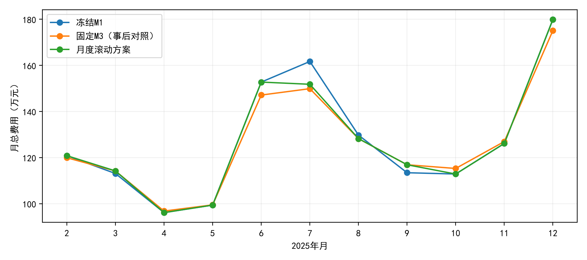
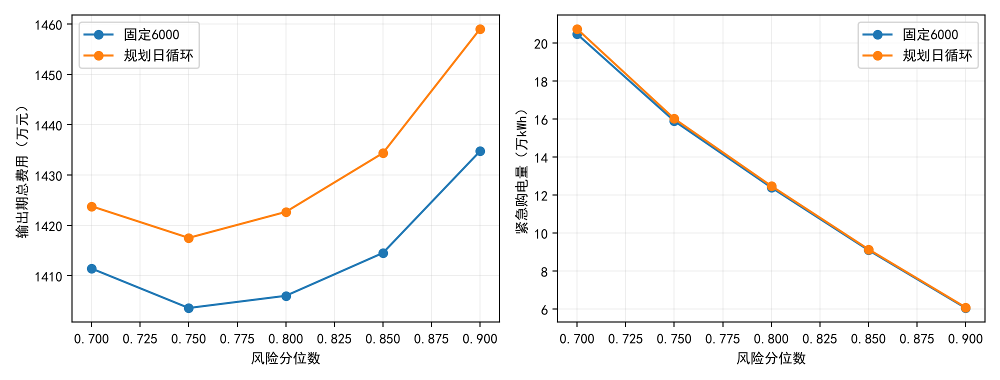

# 问题二：基于历史风险校准与滚动选模的日前购电策略

## 1. 问题分析与思路构建

问题二每天0:00必须冻结144个10分钟区间的计划购电量。当日负载和光伏具有不确定性，计划电量无论实际是否用完均付费，供电缺口按同时刻正常电价的5倍补购。因此，多购造成已付费电量浪费，少购则暴露于高价补购；储能又把一个时段的决策传递到后续时段，不能仅用预测误差或单槽安全裕量评价整个方案。

据此构建“历史预测—净负载风险校准—日前购电决策—实时储能反馈—按月因果选模”的分层策略。日前储能轨迹是确定购电量的辅助规划变量；实际储能根据当前观测重新反馈，最终结果表记录实际执行充放电量。日前与实时分层及不平衡费用建模参考文献[1]；概率信息应匹配优化结构而非一味增加复杂度[2]；最终以实际购电总费用评价，预测MAE/RMSE只作辅助诊断[5]。

本节进一步检验“规划日循环是否比固定6000更好”“短期选出的模型是否需要随季节调整”，并将费用、风险和物理可行性同时作为判断依据。新增试验属于已观察过2025年数据后的因果历史回测，不能称为完全未接触的最终测试集，也不宣称实现随机真实费用的全局最优。

## 2. 信息集、时间边界与统一假设

### 2.1 每个决策时刻可用的信息

每天0点的信息集由附件1给定的重复日电价、前一日及更早的实际负载和光伏、各历史时点形成的预测/残差，以及当前实际储能构成。当天实测负载和光伏只在运行到相应时段时作为反馈输入，不作为0点已知数据；第二问不使用附件3预报和附件4波动电价。月初模型选择只使用当日以前已发生的历史。

假设当前10分钟区间的平均净负载可及时观测并用于该区间控制。这是离散时间近似，未模拟区间内波动或观测延迟。1月储能实际待机6000 kWh，1月数据用于初始训练和独立影子验证；2月1日至12月31日为334天正式输出期。

### 2.2 计量与物理假设

所有优化流量均在交流母线侧计量，单位kWh；功率kW仅在输入时乘1/6。充、放效率分别0.9，储能范围1200—10800 kWh，10分钟充放电上限5000/6 kWh。不售电、不缺供，允许弃光；多余合同可拒绝利用但不退款，与弃光分别核算。输入沿用标准化数据，未再次平滑、删异常或移动时间轴；未取得清洗前原附件，不能宣称独立复核了原始映射。

实际状态跨日连续。每日规划末端与实际末端是不同概念；评价期初末统一6000只是公平库存比较约定，不是题目要求的每日循环。用于恢复库存的额外购电按5倍价格计费，这也是本项目明确采用的结算解释。

## 3. 历史预测与风险水平

### 3.1 强历史基准

负载采用上周同槽，光伏采用过去7天同槽均值：

$$
\widehat L_{i,t}=L^{\mathrm{act}}_{i-7,t},\qquad
\widehat V_{i,t}=\frac17\sum_{j=1}^{7}V^{\mathrm{act}}_{i-j,t},\qquad
\widehat N_{i,t}=\widehat L_{i,t}-\widehat V_{i,t}.
$$

采用周期基准的理由是既有数据呈现明显周周期；文献[3]支持用周期和日历效应建模，但具体基准的有效性由本题历史数据验证。

### 3.2 改进候选及无未来信息的在线选择

在基准上拟合残差，比较Ridge回归和直方图梯度提升树。输入共11项：基准值、前一日、前一周、过去7天/14天/3天同槽均值、日内正余弦、星期编码及年度正余弦。所有历史统计均截止前一日。年度正余弦只是平滑时间特征，不表示已学到多年的季节规律。

每7天重训一次，最多使用此前56天；Ridge在训练集内标准化，惩罚参数100；树模型40轮、最多7叶、学习率0.08、L2系数10、最多64箱，关闭随机早停，种子2025。参数在本轮预先固定，并未开展大规模网格搜索。Ridge属于正则化回归候选，不声称复现文献[3]的LASSO。

改进配置P1分别对负载、光伏依据过去14天样本外MAE选择基准、回归或树模型；历史不足时回退基准。非负预测截断为零，光伏某槽过去28天一直为零时将预测设为零，不使用目标日实际值识别夜间。

### 3.3 净负载残差分位数

保存当时发布的历史预测，并计算样本外误差：

$$
\varepsilon_{j,t}=N^{\mathrm{act}}_{j,t}-\widehat N_{j,t},\qquad
\widetilde N_{i,t}=\widehat N_{i,t}+Q_\alpha\{\varepsilon_{j,t}:j<i,\ j\text{位于最近56天}\}.
$$

误差最早从1月8日开始积累。本文主参数取$\alpha=0.8$，并做0.7、0.9敏感性分析。负载与光伏误差先合成净负载误差，避免将两者的独立上界简单相加。

在单时段、无储能且多购不退款的特例中，额外购入1 kWh必付正常价格，只有需求超出计划时才能避免5倍补购，因此内部最优超额概率为1/5，给出80%分位数启发。但有储能时边际价值受跨时段约束影响，80%既不是全日最优性定理，也不是全天无紧急购电的可靠性保证。概率预测需另行检查评分与校准[4]。

0.8在本方案中称为“具有经济解释的基准风险水平”。分位数在有储能全日问题中不是最优性证明；后续敏感性也允许发现其他分位数费用更低，不能把0.8附近稳定作为预定结论。P1内部按此前14天MAE选预测器，调度模型标签则按历史实际运行费用选取，这两层选择依据不同。

## 4. 日前优化、实时执行与终端处理

### 4.1 风险修正LP/MILP

当天0点已知实际初始储能，求解：

$$
\min\ \sum_{t=0}^{143}p_tg_{i,t},
$$

$$
g_{i,t}+d^0_{i,t}-c^0_{i,t}-a^0_{i,t}=\widetilde N_{i,t},
\qquad
E^0_{i,t+1}=E^0_{i,t}+0.9c^0_{i,t}-d^0_{i,t}/0.9,
$$

$$
1200\le E^0_{i,t}\le10800,\quad
0\le c^0_{i,t}\le(5000/6)z_{i,t},\quad
0\le d^0_{i,t}\le(5000/6)(1-z_{i,t}),
$$

$$
g_{i,t},a^0_{i,t}\ge0,\quad z_{i,t}\in\{0,1\},\quad
E^0_{i,0}=E^{\mathrm{act}}_{i,0},\quad E^0_{i,144}=6000.
$$

其中$a^0$是净负载等效模型的预测剩余电量，不当作实际弃光；$c^0,d^0,E^0$是规划值，输出附件中的充放电则为实际执行值。确定性对照用$\widehat N$替换$\widetilde N$。

数值实现添加每kWh充放电$10^{-7}$元的择优项，仅用于抑制无意义吞吐，不计入实际购电费用，也不解释为电池退化成本。先求LP松弛；若出现同时充放电，则转完整MILP，时间上限30秒、相对间隙阈值$10^{-8}$。每个解再次检查互斥和物理残差，不能将问题一的LP结论无条件推广。

### 4.2 受限场景对照

M4由最近56天中均匀抽取最多14个完整残差日轨迹，叠加当前点预测；场景等权，日前购电、计划充放电和储能状态在各场景共享，紧急补购及剩余电量按场景区分：

$$
\min\ \sum_t p_tg_{i,t}
 +\frac1{|\Omega_i|}\sum_{\omega\in\Omega_i}\sum_t5p_te^\omega_{i,t},
\qquad
g_{i,t}+d^0_{i,t}-c^0_{i,t}+e^\omega_{i,t}-a^\omega_{i,t}
=N^\omega_{i,t}.
$$

其余储能约束同上，$e^\omega,a^\omega\ge0$。旧版曾以28个场景检查敏感性；本次统一采用14个场景，旧版本费用不混入本次对比。

这是共享控制的受限随机规划，不是完整多阶段自适应随机规划。虽然输入保存整日轨迹，但共享控制下，目标只利用各时段经验分布，不能据此证明已充分利用时间联合相关性，也不能将其表现视为对所有随机规划方法的否定。文献[1,2]支持更完整的概率/场景建模，本文仅实现其中计算量较小的对照。

### 4.3 实际执行与费用

对已冻结计划，当前可用盈余为 $x_{i,t}=g_{i,t}+V^{act}_{i,t}-L^{act}_{i,t}$。常规运行日采用F0反馈：盈余时在容量、功率限制下充电，缺口时在储能下界、功率限制下放电。记执行后的盈余 $B^{sur}_{i,t}=x_{i,t}+d^{act}_{i,t}-c^{act}_{i,t}$，则

$$
e_{i,t}=\max\{0,-B^{sur}_{i,t}\},\quad
w_{i,t}=\min\{g_{i,t},\max(B^{sur}_{i,t},0)\},\quad
s_{i,t}=\max(B^{sur}_{i,t},0)-w_{i,t}.
$$

$$
g_{i,t}-w_{i,t}+V^{act}_{i,t}-s_{i,t}+e_{i,t}+d^{act}_{i,t}=L^{act}_{i,t}+c^{act}_{i,t},\qquad
E^{act}_{i,t+1}=E^{act}_{i,t}+0.9c^{act}_{i,t}-d^{act}_{i,t}/0.9.
$$

$$
C_i=\sum_t p_tg_{i,t}+5\sum_t p_te_{i,t},\qquad C=\sum_i C_i.
$$

其中 $w$为已付费未利用合同电量，$s$为实际弃光。储能不得向外网售电或人为丢弃电量，因此还检查 $s\le V^{act}$。F0侧重即时可靠供电，未显式评价未来峰谷电价的实时边际价值；这些价值部分通过日前购电计划体现。

### 4.4 规划日循环对照与评价末端修正

基准T0设 $E^0_{i,144}=6000$。规划日循环T1设

$$
E^0_{i,0}=E^{act}_{i,0},\qquad E^0_{i,144}=E^{act}_{i,0},\qquad
E^{act}_{i,0}=E^{act}_{i-1,144}.
$$

T1不要求实际每日首尾相等，两组各自传递实际SOC，不能将T0的状态直接拿给T1使用。循环目标可减少固定库存追踪，但可能延续低库存；固定6000有库存恢复作用，也可能增加购电。两者都属于额外终端假设，优劣由实验检验。

本次短窗口复核发现，旧评价末端包络仅考虑额定放电上限，可能在实际负载较小时强制超负载放电，将电池电量误计为弃光。新闭合日规则提前管理库存：若当前储能高于目标 $E^*$，取 $c=0$，$d=\min\{5000/6,L^{act},0.9(E-E^*)\}$；若不高于目标，则沿用盈缺反馈，但将下一状态上界限制为 $\min\{E^*,E+0.9(5000/6)\}$，下界限制为 $\max\{1200,E^*-(143-t)0.9(5000/6),E-(5000/6)/0.9\}$。缺少的电量仍按5倍价格补购。到期若实际需求不足以消纳必要放电，则明确判不可达，不伪造状态或弃光。

该保守规则只用于每次影子窗口的最后一天和正式输出期12月31日，不在每月底对实际系统重置状态。它会改变末日成本，不能把新旧版本的全部差额归因于模型优化；相关成本影响单列报告。

## 5. 模型比较与最终方案确定

### 5.1 实验组的作用

| 组别 | 预测 | 风险处理 | 日前目标 | 用途 |
|---|---|---|---|---|
| M0 | P0历史基准 | 无 | 计划费 | 确定性对照 |
| M1 | P0 | 分位数修正 | 计划费 | 经济风险基准 |
| M2 | P1在线选择 | 无 | 计划费 | 预测消融 |
| M3 | P1 | 分位数修正 | 计划费 | 预测＋风险对照 |
| M4 | P1 | 14个历史场景，共享储能 | 计划费＋平均5倍补购费 | 受限场景对照 |
| R0 | P0 | 分位数修正 | 直接按修正净负载购电 | 无储能参照 |

### 5.2 1月预选与终端假设选择

所有1月影子试验在1月15—31日连续运行，同起末6000，采用修正后的闭合日规则，按真实历史执行费用比较。

| 模型（T0） | 1月影子总费用（元） |
|---|---|
| M0 | 929,408.72 |
| M1 | 906,355.19 |
| M2 | 953,672.98 |
| M3 | 911,503.80 |
| M4 | 911,182.10 |

| M1终端规则 | 1月影子总费用（元） |
|---|---|
| T0 | 906,355.19 |
| T1 | 910,680.89 |

两项比较均支持2月以M1、固定6000规划目标启动，分位数0.8保持预设。后续T2/T3或0.75的输出期费用即使更低，也不追溯替换这一初始选择。

### 5.3 每月滚动选模

从3月起，每月1日以之前最多56天、最早1月15日起的历史进行M1/M3/M4影子回放，选择累计总费用最小者，平局按模型名排序；选中标签固定至下月。每个候选影子窗口同起末6000，但真实系统沿用上一天实际状态，每天0点重新求解计划。历史窗口只决定模型标签，影子SOC不写入真实运行。该时间推进方式遵循滚动起点验证原则[7]。

| 运行月份 | 影子起始日 | 影子末日 | 选中模型 |
|---|---|---|---|
| 2月 | 2025-01-15 | 2025-01-31 | M1 |
| 3月 | 2025-01-15 | 2025-02-28 | M3 |
| 4月 | 2025-02-04 | 2025-03-31 | M1 |
| 5月 | 2025-03-06 | 2025-04-30 | M1 |
| 6月 | 2025-04-06 | 2025-05-31 | M1 |
| 7月 | 2025-05-06 | 2025-06-30 | M4 |
| 8月 | 2025-06-06 | 2025-07-31 | M3 |
| 9月 | 2025-07-07 | 2025-08-31 | M3 |
| 10月 | 2025-08-06 | 2025-09-30 | M1 |
| 11月 | 2025-09-06 | 2025-10-31 | M1 |
| 12月 | 2025-10-06 | 2025-11-30 | M1 |

**最终交付方案：固定6000规划目标（T0）＋月度历史费用滚动选择M1/M3/M4＋当前区间F0储能反馈＋评价末日物理可行库存恢复。** 这是在本次复审中固定规则后重放的因果策略，不冒充2025年之前已注册的策略；全年固定M3只是事后对照，未被反向用于2月1日选模。

### 5.4 输出期总费用与风险

| 方案 | 总费用（元） | 紧急购电量（kWh） | 紧急天数 | 合并事件数 |
|---|---|---|---|---|
| R0_T0 | 18,567,635.66 | 271,671.99 | 331 | 3550 |
| M0_T0 | 15,301,488.42 | 507,151.27 | 296 | 696 |
| M1_T0 | 14,060,174.45 | 123,915.39 | 105 | 167 |
| M2_T0 | 15,016,478.05 | 446,373.56 | 295 | 703 |
| M3_T0 | 13,899,119.64 | 94,904.17 | 122 | 185 |
| M4_T0 | 13,969,798.12 | 77,930.71 | 117 | 174 |
| Rolling_T0 | 13,991,435.14 | 119,025.32 | 118 | 187 |
| Rolling_T1 | 14,146,330.28 | 120,363.59 | 118 | 186 |

主方案总费用为**13,991,435.14元**，其中计划费13,260,497.39元、紧急费730,937.75元。相对同闭合规则冻结M1节约68,739.31元（0.489%），相对无储能R0节约4,576,200.52元（24.65%）。主方案紧急购电118天，187个合并事件，618个非零10分钟槽，三者不是同一统计量。

相对冻结M1，紧急购电总量减少4,890.07 kWh，但补购天数由105增至118，事件数由167增至187。本方案以总费用为首要指标，并非所有风险指标同时改善。

固定M3费用13,899,119.64元，仍比滚动策略低92,315.50元。这表明滚动选择解决了使用历史动态选模的可实施性，但并未取得事后最优候选的全部收益；不能据此宣称滚动策略一定优于所有固定策略。

## 6. 终端与参数敏感性

### 6.1 固定6000与规划日循环

| 规则 | 总费用（元） | 紧急电量（kWh） | 低于2400日初SOC天数 |
|---|---|---|---|
| T0 | 14,060,174.45 | 123,915.39 | 0 |
| T1 | 14,226,847.95 | 124,714.83 | 0 |
| T2 | 14,046,364.70 | 124,867.43 | 0 |
| T3 | 14,077,102.27 | 124,010.27 | 0 |
| T4 | 14,059,626.97 | 141,894.78 | 232 |

T1比T0多支出166,673.50元（1.19%），紧急购电增加799.43 kWh。本数据下，规划日循环没有改善总成本，故未替换T0。2400仅是低库存统计阈值，不是新增控制约束。T2/T3/T4只作事后敏感性，不据此追选正式终端。

| 月份 | T1减T0费用（元） |
|---|---|
| 2025-02 | 9,127.88 |
| 2025-03 | 10,916.62 |
| 2025-04 | 11,900.76 |
| 2025-05 | 12,070.42 |
| 2025-06 | 18,554.87 |
| 2025-07 | 24,337.64 |
| 2025-08 | 20,549.62 |
| 2025-09 | 22,138.68 |
| 2025-10 | 16,595.39 |
| 2025-11 | 10,916.43 |
| 2025-12 | 9,565.19 |

### 6.2 末端库存与版本差异

| M1配置 | 输出期费用（元） | 末端库存（kWh） |
|---|---|---|
| M1_T0 | 14,060,174.45 | 6,000.00 |
| M1_T0_open | 14,014,641.48 | 6,368.66 |
| M1_T1 | 14,226,847.95 | 6,000.00 |
| M1_T1_open | 14,181,399.59 | 10,800.00 |

保守闭合日规则使T0费用相对旧规则增加45,532.97元，差异来自12月31日执行；此前计划已验证一致。旧M1费用14,014,641.48元与新方案采用不同闭合策略，不能把两者差额全部称为滚动选模收益。无闭合组库存不同，只报告费用与库存，不直接宣称节约。

### 6.3 风险水平、初值与误差压力

| 分位数 | T0费用（元） | T1费用（元） | T0紧急电量（kWh） |
|---|---|---|---|
| 0.7 | 14,114,321.58 | 14,238,025.27 | 204,665.63 |
| 0.75 | 14,035,939.21 | 14,175,233.20 | 158,953.99 |
| 0.8 | 14,060,174.45 | 14,226,847.95 | 123,915.39 |
| 0.85 | 14,145,360.25 | 14,343,774.65 | 90,952.24 |
| 0.9 | 14,347,457.57 | 14,590,239.06 | 60,502.44 |

本次0.75的事后费用低于0.8；提高风险分位数减少补购，但增加付费未利用电量。费用曲线较平缓不能解释为风险电量也稳定；0.8为预设经济基准，不以这张输出期表反向调参。

| 压力配置 | 费用（元） | 紧急电量（kWh） | 期末SOC（kWh） |
|---|---|---|---|
| M1_T0_initial3600.0 | 14,088,223.27 | 128,411.72 | 3,600.00 |
| M1_T0_initial8400.0 | 14,038,973.87 | 122,144.44 | 8,400.00 |
| M1_T0_scale0.75 | 13,600,028.59 | 93,200.49 | 6,000.00 |
| M1_T0_scale1.25 | 14,536,448.60 | 157,272.65 | 6,000.00 |
| M1_T1_initial3600.0 | 14,253,621.89 | 129,211.16 | 3,600.00 |
| M1_T1_initial8400.0 | 14,201,516.70 | 120,394.83 | 8,400.00 |
| M1_T1_scale0.75 | 13,736,020.65 | 93,770.31 | 6,000.00 |
| M1_T1_scale1.25 | 14,733,339.91 | 158,265.83 | 6,000.00 |

初值3600/8400组均恢复各自初值，只能同初值配对比较，正式初值仍为6000。误差压力为P0预测加原历史误差的0.75或1.25倍，并对负载、光伏非负截断；预测缓存保持固定，只有此前合成实际进入残差校准。它是合成扰动下的离线稳健性诊断，不是额外真实观测。

### 6.4 实时MPC与场景增强的取舍

F1每个时段固定已付费计划、用当前实测和未来预测最小化剩余日内5倍补购费用，并只执行首个动作；两槽测试验证了为高价缺口保留储能的行为。2月1—7日共同闭合规则下，F0费用374,573.34元，F1费用395,840.15元，F1增加5.68%，最大单日耗时0.897秒。短窗口未显示收益，按试验门槛停止扩大；未据此宣称所有MPC均不适用。F1不改变日前计划，允许按5倍价格补购用于储能，但仍不得售电或丢弃电池能量。

完整场景自适应储能已形成节点变量、非预见性与树外执行的设计说明；当前未实现和验证完整场景树，故不进入正式结果。M4已具有场景专属补购变量，可解释为受限两阶段补救模型，不能笼统说它不是随机规划；其储能动作共享，不能代替具有场景节点自适应储能的多阶段模型。

MPC试验的最后一天与F0采用同一库存闭合反馈，其余六天才使用剩余日MPC；两组每日购电均从自身实际日初状态重新计算，不能视为整周购电量逐槽完全相同的实验。

## 7. 四个指定日期的具体策略

购电为0点冻结计划，充放电及SOC为实际执行值。展示保留两位小数，附件保存完整计算精度。

### 2025-03-20

| 时间段 | 计划购电量（kWh） |
|---|---|
| 10:00—10:10 | 0.00 |
| 12:00—12:10 | 619.98 |
| 14:00—14:10 | 0.00 |
| 16:00—16:10 | 485.87 |
| 18:00—18:10 | 708.80 |
| 20:00—20:10 | 0.00 |

| 指标 | 数值 |
|---|---|
| 全天计划购电量（kWh） | 69,026.15 |
| 全天计划购电费（元） | 41,887.07 |
| 紧急购电量（kWh） | 0.00 |
| 紧急购电费（元） | 0.00 |
| 全天总费用（元） | 41,887.07 |
| 0:00储电量（kWh） | 6,740.62 |
| 24:00储电量（kWh） | 6,491.43 |

| 时间段 | 实际充电量（kWh） | 实际放电量（kWh） |
|---|---|---|
| 0:00-4:00 | 4,032.09 | 126.36 |
| 4:00-8:00 | 898.14 | 5,456.77 |
| 8:00-12:00 | 6,236.31 | 2,777.38 |
| 12:00-16:00 | 3,979.97 | 450.99 |
| 16:00-20:00 | 282.28 | 5,590.02 |
| 20:00-24:00 | 5,709.15 | 2,944.48 |

### 2025-06-21

| 时间段 | 计划购电量（kWh） |
|---|---|
| 10:00—10:10 | 0.00 |
| 12:00—12:10 | 0.00 |
| 14:00—14:10 | 0.00 |
| 16:00—16:10 | 243.15 |
| 18:00—18:10 | 0.00 |
| 20:00—20:10 | 0.00 |

| 指标 | 数值 |
|---|---|
| 全天计划购电量（kWh） | 37,190.12 |
| 全天计划购电费（元） | 22,089.77 |
| 紧急购电量（kWh） | 0.00 |
| 紧急购电费（元） | 0.00 |
| 全天总费用（元） | 22,089.77 |
| 0:00储电量（kWh） | 7,906.34 |
| 24:00储电量（kWh） | 8,388.35 |

| 时间段 | 实际充电量（kWh） | 实际放电量（kWh） |
|---|---|---|
| 0:00-4:00 | 795.89 | 1,214.20 |
| 4:00-8:00 | 461.62 | 4,391.76 |
| 8:00-12:00 | 8,878.60 | 0.00 |
| 12:00-16:00 | 0.00 | 0.00 |
| 16:00-20:00 | 278.88 | 5,157.72 |
| 20:00-24:00 | 6,478.07 | 2,485.90 |

### 2025-09-23

| 时间段 | 计划购电量（kWh） |
|---|---|
| 10:00—10:10 | 0.00 |
| 12:00—12:10 | 523.39 |
| 14:00—14:10 | 0.00 |
| 16:00—16:10 | 599.81 |
| 18:00—18:10 | 797.07 |
| 20:00—20:10 | 0.00 |

| 指标 | 数值 |
|---|---|
| 全天计划购电量（kWh） | 72,427.69 |
| 全天计划购电费（元） | 45,370.45 |
| 紧急购电量（kWh） | 0.00 |
| 紧急购电费（元） | 0.00 |
| 全天总费用（元） | 45,370.45 |
| 0:00储电量（kWh） | 6,684.71 |
| 24:00储电量（kWh） | 6,986.76 |

| 时间段 | 实际充电量（kWh） | 实际放电量（kWh） |
|---|---|---|
| 0:00-4:00 | 4,425.94 | 11.76 |
| 4:00-8:00 | 432.27 | 5,610.22 |
| 8:00-12:00 | 5,974.68 | 1,896.62 |
| 12:00-16:00 | 3,637.03 | 507.79 |
| 16:00-20:00 | 26.02 | 5,495.19 |
| 20:00-24:00 | 6,059.09 | 2,856.15 |

### 2025-12-21

| 时间段 | 计划购电量（kWh） |
|---|---|
| 10:00—10:10 | 0.00 |
| 12:00—12:10 | 1,025.56 |
| 14:00—14:10 | 0.00 |
| 16:00—16:10 | 845.46 |
| 18:00—18:10 | 748.00 |
| 20:00—20:10 | 0.00 |

| 指标 | 数值 |
|---|---|
| 全天计划购电量（kWh） | 99,653.24 |
| 全天计划购电费（元） | 64,408.93 |
| 紧急购电量（kWh） | 0.00 |
| 紧急购电费（元） | 0.00 |
| 全天总费用（元） | 64,408.93 |
| 0:00储电量（kWh） | 6,647.84 |
| 24:00储电量（kWh） | 6,617.31 |

| 时间段 | 实际充电量（kWh） | 实际放电量（kWh） |
|---|---|---|
| 0:00-4:00 | 4,403.72 | 126.93 |
| 4:00-8:00 | 1,195.14 | 1,496.97 |
| 8:00-12:00 | 6,030.11 | 6,711.90 |
| 12:00-16:00 | 6,016.52 | 2,220.11 |
| 16:00-20:00 | 0.00 | 5,603.62 |
| 20:00-24:00 | 5,789.72 | 2,850.47 |

### 指定日紧急购电汇总（对应表3）

| 日期 | 紧急购电区间 | 购电量（kWh） |
|---|---|---|
| 2025-03-20 | 无 | 0.00 |
| 2025-06-21 | 无 | 0.00 |
| 2025-09-23 | 无 | 0.00 |
| 2025-12-21 | 无 | 0.00 |

四个指定日中，发生紧急购电的日期为：无；其余指定日为0。相邻非零10分钟槽合并且不跨日，统计阈值为1e-7 kWh。此结论由新方案数据自动生成，不沿用旧方案的指定日结论。

## 8. 验证、适用边界与附件

主方案48,096条10分钟轨迹已检查母线平衡、SOC递推、功率及状态边界、非负、充放电互斥、实际跨日连续和期末库存。该组日前转MILP天数为0，LP最大原始—对偶绝对差为9.46e-11元；不将这一证据解释为真实随机总费用最优。导出Excel另由独立复核器读取全部计划、334天储能及紧急事件，并对每一天重建0点计划，详见交付验证附件。

局限包括一年样本、1月初选季节单一、已进行历史探索、当前槽平均值可及时观测的近似、固定目标和保守闭合日策略、简单实时反馈，以及M4未包含自适应储能。没有宣称完整随机规划/MPC已实现全年提升，也没有把更低的事后结果当作事前可知选择。

- [正式结果result2.xlsx](result2.xlsx)
- [完整10分钟执行账本](dispatch_10min.csv)
- [每日费用与规划/实际SOC](daily_summary.csv)
- [模型与敏感性对比](comparison.csv)
- [逐月比较](monthly_comparison.csv)
- [分季比较](seasonal_comparison.csv)
- [事前信息约束与最终选择协议](selection_protocol.json)
- [月度选择依据](rolling_selection_T0.csv)
- [旧版重现及闭合规则差异](baseline_reproduction.json)
- [导出Excel独立交付验证](delivery_verification.json)
- [输入及代码哈希](source_hashes.json)

[优化文献核查](../../docs/第二问优化文献核查.md)；[场景自适应储能设计及门槛](../../docs/第二问场景自适应模型说明.md)。

## 参考文献

[1] Appino R R, González Ordiano J Á, Mikut R, Hagenmeyer V, Faulwasser T. Storage Scheduling with Stochastic Uncertainties: Feasibility and Cost of Imbalances[C]. PSCC, 2018. [公开作者稿及元数据](https://arxiv.org/abs/1805.02525)，[全文](https://arxiv.org/pdf/1805.02525)。用于两阶段计划、储能偏差与不平衡费用的建模依据。

[2] Beykirch M, Janke T, Steinke F. Bidding and Scheduling in Energy Markets: Which Probabilistic Forecast Do We Need?[C]. PMAPS, 2022. [公开作者稿及元数据](https://arxiv.org/abs/2203.13159)。用于说明储能状态关联与预测分布需求，未据此宣称本次受限场景已实现完整联合优化。

[3] Ziel F, Liu B. Lasso estimation for GEFCom2014 probabilistic electric load forecasting[J]. International Journal of Forecasting, 2016, 32(3): 1029–1037. DOI: [10.1016/j.ijforecast.2016.01.001](https://doi.org/10.1016/j.ijforecast.2016.01.001). [公开作者稿](https://arxiv.org/abs/1603.01376)。支持周期、日历与正则化思想，本文Ridge不是原模型复现。

[4] Gneiting T, Lerch S, Schulz B. Probabilistic solar forecasting: Benchmarks, post-processing, verification[J]. Solar Energy, 2023, 252: 72–80. DOI: [10.1016/j.solener.2022.12.054](https://doi.org/10.1016/j.solener.2022.12.054). [开放全文](https://publikationen.bibliothek.kit.edu/1000155949/150349405)。用于基准、概率评分与校准依据。

[5] Donti P L, Amos B, Kolter J Z. Task-based End-to-end Model Learning in Stochastic Optimization[C]. Advances in Neural Information Processing Systems 30, 2017. [公开作者稿及出版信息](https://arxiv.org/abs/1703.04529)。用于下游成本导向评价，本文未实现其端到端神经优化。

[6] Gupta R K, Sossan F, Paolone M. Grid-aware Distributed Model Predictive Control of Heterogeneous Resources in a Distribution Network: Theory and Experimental Validation[EB/OL]. 2020（公开作者稿年份）. arXiv:2008.02848. [公开作者稿](https://arxiv.org/abs/2008.02848)。用于日前/实时分层架构，本文未引入原文网络参数与多设备控制。

[7] Hyndman R J, Athanasopoulos G. Forecasting: Principles and Practice[M/OL]. 3rd ed., §5.10 Time series cross-validation. [作者公开教材](https://otexts.com/fpp3/tscv.html)。本文时间顺序验证遵循该原则，不使用随机时段划分。

文献访问日期：2026-09-11。论文与作者稿用于支持方法及适用边界，所有本题费用、精度与收益数字均来自本项目计算，不引用其他系统的收益比例作为本题结果。
